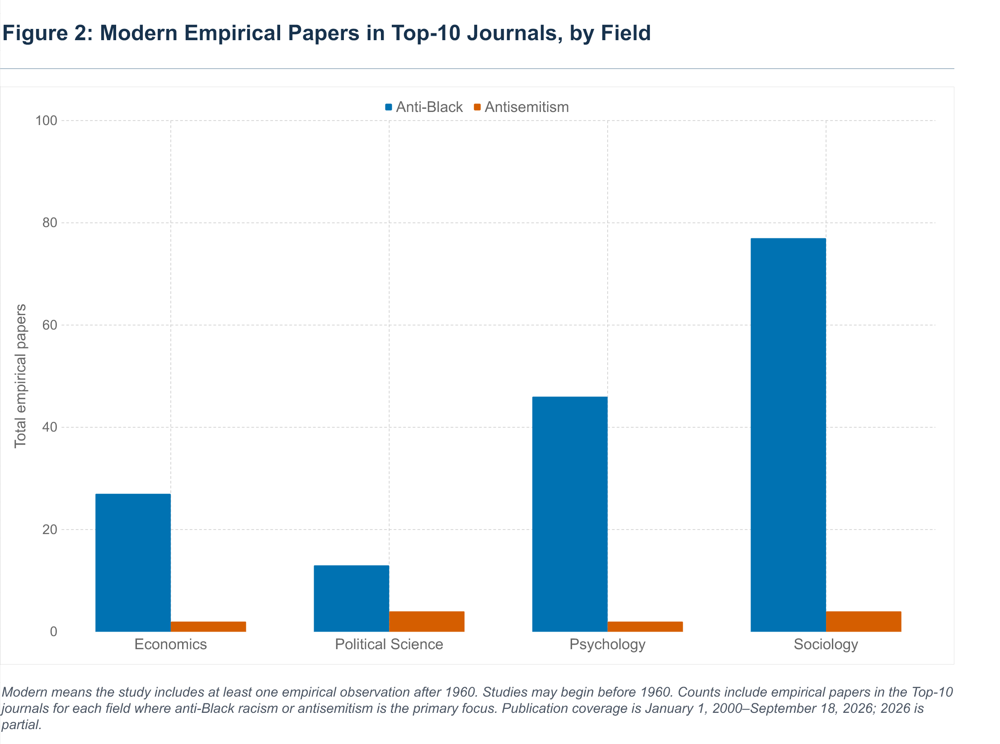

# Measuring Antisemitism: Welcome — Figure 2

Replication materials for Figure 2 of the supplied “Welcome” essay introducing Measuring Antisemitism, the Brodie Center for Jewish and Israeli Law at Yale Law School’s blog.



## Results

| Field | Anti-Black racism | Antisemitism |
|---|---:|---:|
| Economics | 27 | 2 |
| Political Science | 13 | 4 |
| Psychology | 46 | 2 |
| Sociology | 77 | 4 |
| **Total** | **163** | **12** |

Counts are empirical papers classified A (primary focus) in the supplied 40-journal universe, published January 1, 2000–September 18, 2026, with at least one empirical observation after 1960. A study may begin before 1960; 2026 is partial. The journal set is a prestige composite, not a unique mechanically ranked top ten.

**Arithmetic correction:** these counts imply 163 / 12 = **13.58**, rather than the paper’s “more than 15” statement. The paper and workbook are preserved without silently changing their claims.

## Reproduce the figure

Requires Python 3.10 or later. From the repository root:

```sh
python -m venv .venv
# Activate the environment using the command appropriate to your operating system.
python -m pip install -r requirements.txt
python scripts/reproduce_figure2.py
```

The script reads cells X1:Z5 of the workbook’s `Figure 2` sheet, exports `data/figure2_counts.csv`, checks the supplied eight counts, and writes PNG, SVG and PDF charts plus `data/figure2_summary.json`. It also computes the unfiltered empirical A totals from the master records and compares them to the workbook’s discipline summary. The recreated chart reproduces the counts and grouped-bar structure; `figure2-original.png` preserves the exact published appearance.

## Contents

- `data/`: original workbook, readable CSV exports, figure counts and arithmetic checks.
- `figures/`: image extracted from the paper and regenerated charts.
- `scripts/reproduce_figure2.py`: executable workbook-to-chart reproduction.
- `prompts/`: recovered prompt excerpts and clearly labeled reconstructed prompts.
- `docs/methodology.md`: definitions, provenance and limits.
- `docs/checksums.json`: SHA-256 fingerprints of supplied workbook and original figure.

## Scope and verification limits

This repository reproduces the supplied Figure 2 aggregates. It does **not** independently certify a complete article census or reproduce the post-1960 article selection from raw records. The master spreadsheet has no structured modern-period inclusion flag or observation dates. Its unfiltered empirical A counts are 177 anti-Black and 22 antisemitism papers, while Figure 2 reports 163 and 12 after the modern restriction. Article identifiers for the removed studies and the original filtering script were not supplied.

The workbook describes Crossref/OpenAlex retrieval and metadata screening, but raw retrieval responses, executable collection code, a full model transcript, model version and run parameters were not supplied. Workbook statements about completeness and adjudication are source claims, not independently verified findings of this repository. GPT outputs can misclassify articles; full-text review and a retained inclusion ledger are needed to audit the substantive counts.

Only Figure 2 is covered. The full essay is not redistributed here. No reuse license has been inferred for the supplied materials.
