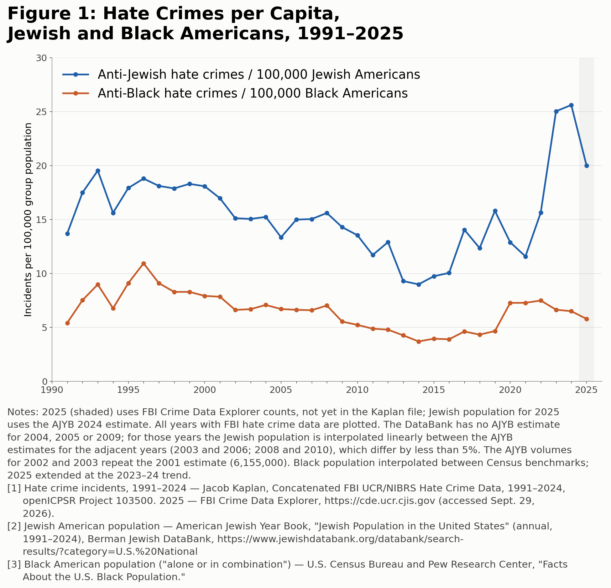
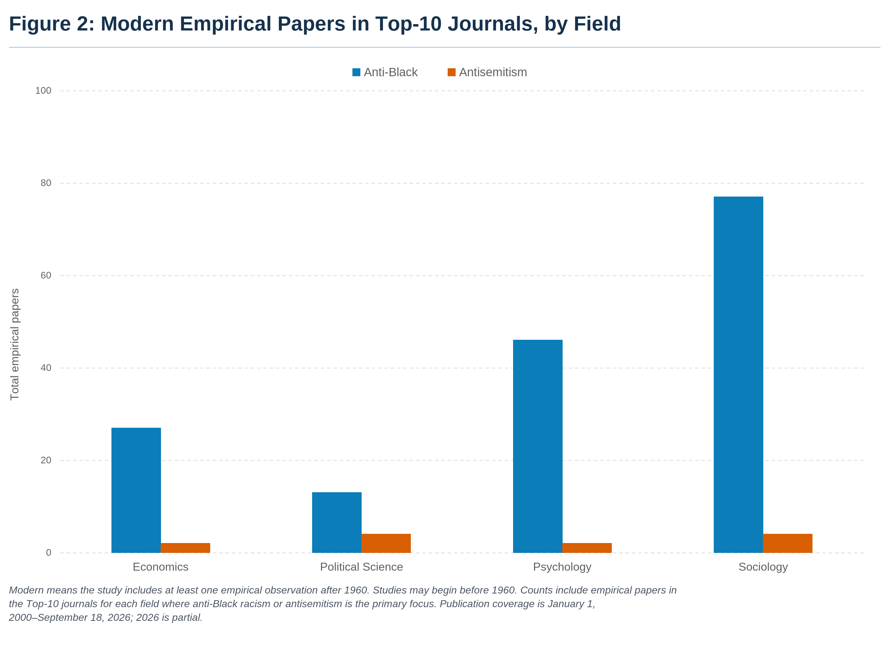
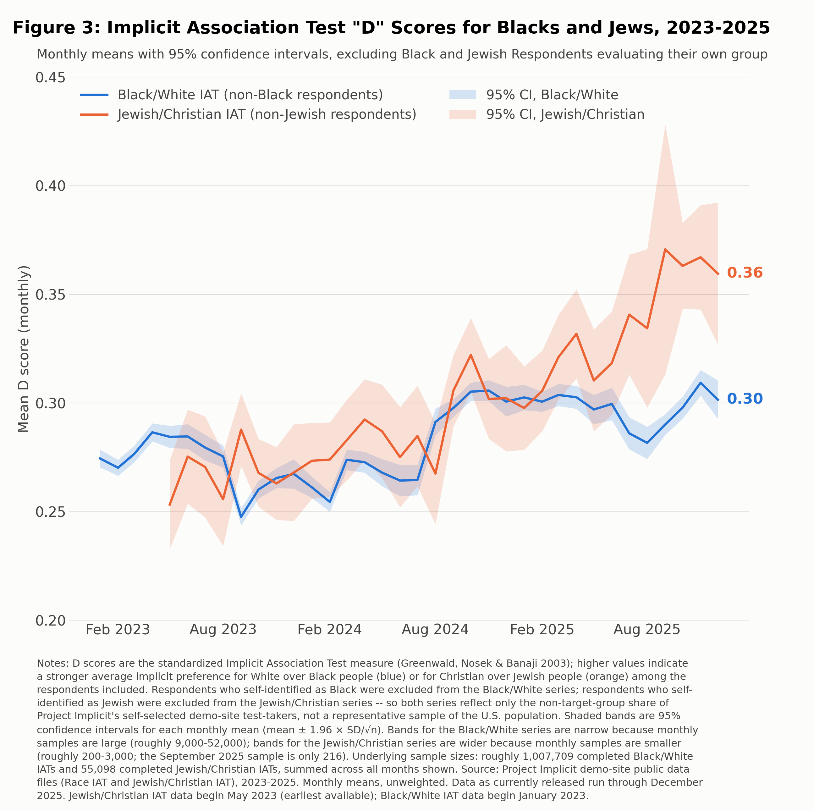

# Measuring Antisemitism — Welcome post: data and code

This repository holds the data, code and reproduction instructions for the three figures in
**"Welcome to Measuring Antisemitism"**, the first post of the Brodie Center for Jewish and Israeli Law
(Yale Law School) blog on empirical studies of antisemitism, by Yair Listokin and Yehonatan Givati.

**Read the post:** <https://ylistokin.github.io/measuring-antisemitism-welcome/>

| Figure | What it shows | Folder |
|---|---|---|
| 1 | Anti-Jewish and anti-Black hate crimes per 100,000 group members, 1991–2025 (FBI) | [`figure1/`](figure1/) |
| 2 | Modern empirical papers on anti-Black racism vs. antisemitism in top-10 journals, 2000–2026, by field | [`figure2/`](figure2/) |
| 3 | Monthly Implicit Association Test D scores, Black/White vs. Jewish/Christian, 2023–2025 (Project Implicit) | [`figure3/`](figure3/) |

<p align="center">
  
  
  
</p>

## Setup

Python 3.12 (CI) or 3.13 (tested). Every package is pinned to an exact version in
[`requirements.txt`](requirements.txt), because plotting-library updates change the rendered figures.

```bash
python -m venv .venv
# Windows: .venv\Scripts\activate    macOS/Linux: source .venv/bin/activate
python -m pip install -r requirements.txt
```

Run every command below from the repository root. Each script overwrites its outputs; to confirm they reproduce the
committed files, run

```bash
python check_outputs.py
```

which requires every CSV and SVG to be byte-identical and every PNG to be pixel-identical (PNG compressed bytes
depend on each platform's zlib build, so PNGs are compared after decoding), and reports any difference.

## Reproduce each figure

### Figure 1 — hate crimes per capita

```bash
python figure1/scripts/make_figure1.py
```

- **Reads** `figure1/data/kaplan_annual_by_bias.csv` (annual incidents by bias, 1991–2024). The 2025 counts and the
  Jewish and Black population series are written into the script; their sources are in
  [`figure1/README.md`](figure1/README.md).
- **Writes** `figure1/outputs/figure1_hate_crime_per_capita_ajyb.png` and `.csv` (rates and ratio for every year).
- **From raw data (optional):** download Jacob Kaplan's `ucr_hate_crimes_1991_2024.csv` (~800 MB, openICPSR 103500,
  V12.1, free registration) and run `python figure1/scripts/build_kaplan_annual.py path/to/ucr_hate_crimes_1991_2024.csv`,
  which regenerates the data file exactly.

### Figure 2 — journal census

```bash
python figure2/scripts/build_figure2.py
python -m unittest discover -s figure2/tests -v
```

- **Reads** the census workbook `figure2/data/source/racism_antisemitism_census_with_modern_figure_2.xlsx`
  (checksum verified) and the 24 adjudicated pre-1960 exclusions in `figure2/data/period_exclusions.csv`.
- **Writes** CSV exports of the workbook's census sheets, the paper-level ledger `figure2/data/figure2_papers.csv`,
  and `figure2/outputs/figure_2_modern_top_10_journals.{png,svg}` plus `figure_2_counts.csv`.
- **Checks** the counts (163 anti-Black, 12 antisemitism) against the published figure and against the
  workbook's own Figure 2 and By Discipline sheets. The workbook is the earliest preserved input; how it was
  produced is documented in [`figure2/README.md`](figure2/README.md).

### Figure 3 — implicit bias

```bash
python figure3/scripts/make_figure3.py
```

- **Reads** `figure3/data/race_iat_monthly_nonblack.csv` and `figure3/data/jewish_iat_monthly_nonjewish.csv`.
- **Writes** `figure3/outputs/figure3_iat_black_jewish_ci.png`.
- **From raw data (optional):** download the Project Implicit demo-site files from OSF (~1.6 GB), run
  `python -m pip install -r requirements-raw.txt`, then run `figure3/scripts/build_iat_monthly.py` as shown in
  [`figure3/README.md`](figure3/README.md); it regenerates both data files exactly.

## Continuous integration

[`.github/workflows/reproduce.yml`](.github/workflows/reproduce.yml) runs on every push and pull request. It installs
the pinned requirements, regenerates all three figures, runs the Figure 2 tests, and runs `check_outputs.py`, which
fails if any text output changes by a byte, any PNG changes by a pixel, or any new file appears. The regenerated outputs are attached to each run as a downloadable artifact.

## Repository layout

```
index.md, _config.yml     the post, served by GitHub Pages
figure1/                  FBI hate crimes per capita: data/, scripts/, outputs/
figure2/                  journal census: data/source/ (workbook), data/, scripts/, tests/, prompts/, docs/, fonts/, outputs/
figure3/                  Project Implicit IAT D scores: data/, scripts/, outputs/
requirements.txt          exact package versions; requirements-raw.txt adds pyreadstat for Figure 3's raw rebuild
check_outputs.py          verifies regenerated outputs against the committed files
.gitattributes            LF line endings everywhere, so text outputs are byte-identical across operating systems
```

## Sources

- Jacob Kaplan, *Concatenated FBI UCR/NIBRS Hate Crime Data, 1991–2024*, openICPSR Project 103500 (V12.1).
- FBI Crime Data Explorer, <https://cde.ucr.cjis.gov> (2025 counts, accessed Sept. 29, 2026).
- American Jewish Year Book, "Jewish Population in the United States," Berman Jewish DataBank.
- U.S. Census Bureau and Pew Research Center, "Facts About the U.S. Black Population."
- Crossref / OpenAlex metadata for the journal census (Figure 2).
- Project Implicit demo-site public data: Race IAT and Jewish/Christian IAT, 2023–2025 (OSF).

## Citation and license

See [`CITATION.cff`](CITATION.cff). Code is MIT-licensed ([`LICENSE`](LICENSE)); the bundled Liberation Sans font is
under the SIL Open Font License ([`figure2/fonts/LICENSE-LiberationSans.txt`](figure2/fonts/LICENSE-LiberationSans.txt));
third-party data remain subject to their providers' terms.
