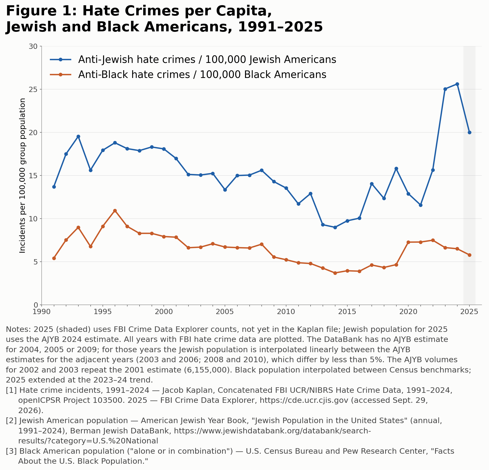

# Figure 1: Hate crimes per capita, Jewish and Black Americans, 1991–2025



Annual anti-Jewish hate crime incidents per 100,000 Jewish Americans and anti-Black incidents per
100,000 Black Americans.

## Reproduce

```bash
python figure1/scripts/make_figure1.py
```

Writes `outputs/figure1_hate_crime_per_capita_ajyb.png` and `outputs/figure1_hate_crime_per_capita_ajyb.csv`
(incidents, populations, rates and the Jewish-to-Black ratio for every year).

### Optional: rebuild the incident counts from the raw FBI file

`data/kaplan_annual_by_bias.csv` is derived from Jacob Kaplan's concatenated FBI hate crime file
(openICPSR Project 103500, V12.1; `ucr_hate_crimes_1991_2024.csv`, ~800 MB, free registration required):
<https://www.openicpsr.org/openicpsr/project/103500>.

```bash
python figure1/scripts/build_kaplan_annual.py path/to/ucr_hate_crimes_1991_2024.csv
```

Each record flagged "one or more hate crime incidents present" is one incident. An incident counts toward
a bias if any of its up to 10 offenses lists that bias, so an incident with both anti-Black and anti-Jewish
offenses counts in both columns. This script reproduces the committed file exactly.

## Inputs and assumptions

| Item | Source | Notes |
|---|---|---|
| Incidents, 1991–2024 | Kaplan, openICPSR 103500 | `data/kaplan_annual_by_bias.csv` |
| Incidents, 2025 | FBI Crime Data Explorer, national totals (accessed Sept. 29, 2026) | Anti-Jewish 1,540; anti-Black 2,847. Preliminary; single-bias counts. Shaded in the figure. |
| Jewish population | American Jewish Year Book, "Jewish Population in the United States," via Berman Jewish DataBank | Hard-coded in `make_figure1.py`. 2004, 2005, 2009 interpolated (no volume); 2002–2003 volumes repeat 2001; 2025 uses 2024. |
| Black population ("alone or in combination") | Census Bureau / Pew Research Center benchmarks | 1991 30.0M, 2000 36.4M, 2010 42.0M, 2020 46.9M, 2023 48.3M, 2024 48.7M; interpolated; 2025 = 49.1M at the 2023–24 trend. |

## Data-quality notes

- **Revision lag.** First-release FBI totals have historically been revised up by 10–20% (e.g. 2021: 9,065
  first release vs. 10,959 final). The 2025 figures may rise once the final file is released.
- **2025 counting rule differs.** The Crime Data Explorer counts single-bias incidents (multiple-bias
  incidents are a separate category); Kaplan's file counts any-bias. For 2024 the two give 1,988 / 3,063
  (CDE) vs. 1,973 / 3,171 (Kaplan) anti-Jewish / anti-Black.
- **Unresolved discrepancy.** Kaplan's 2000 anti-Black count (2,888) differs from an ADL-compiled
  figure (3,884). Not resolved.
- The Jewish Virtual Library's copy of the AJYB series contains errors (e.g. 2015 listed as 7.16M; the
  AJYB says 6,829,930). Use the DataBank PDFs.
