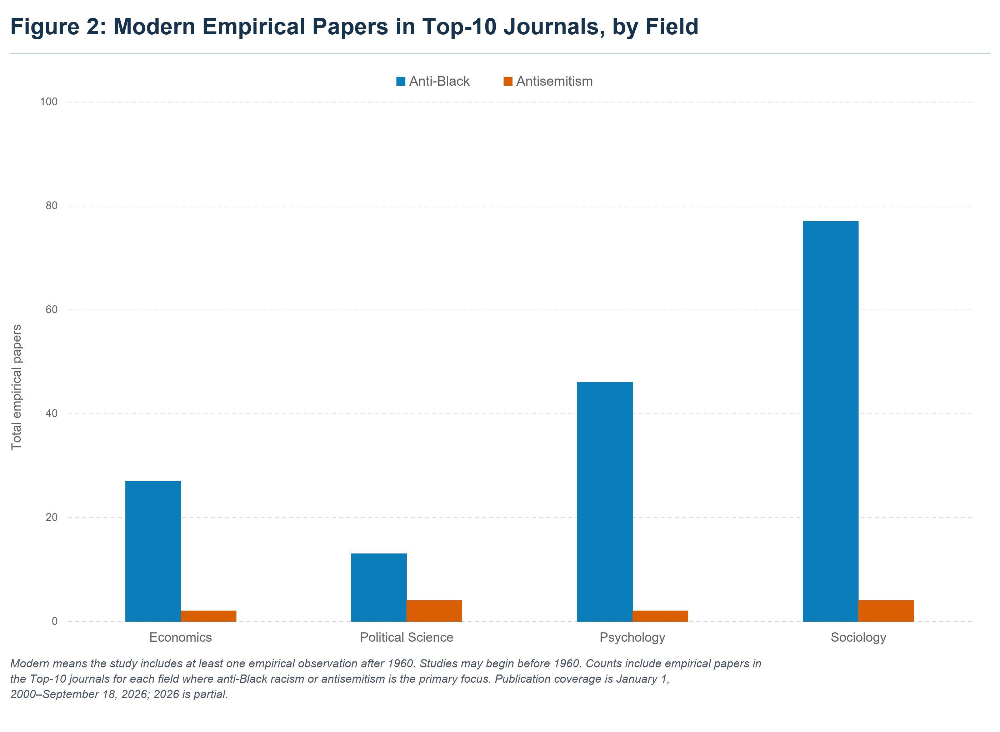

# Figure 2 reproducibility

There are two complementary reproductions in this folder:

1. **From the paper-level ledger** (this page): `scripts/build_figure2.py` counts the papers in `data/figure2_papers.csv`, each with an explicit post-1960 inclusion decision (`include_figure2`), and draws the figure.
2. **From the source workbook** ([REPLICATION_FROM_WORKBOOK.md](REPLICATION_FROM_WORKBOOK.md)): `scripts/reproduce_figure2.py` reads the census workbook, checks the eight published counts and cross-checks the master census (2,159 candidate records in `data/master_census.csv`).

This folder reproduces **Figure 2: Modern Empirical Papers in Top-10 Journals, by Field** from the *Measuring Antisemitism* project.



## Result

The figure counts empirical papers published from January 1, 2000 through September 18, 2026 in ten leading journals in each of economics, political science, psychology, and sociology. A paper is counted when anti-Black racism or antisemitism is its primary focus and its study contains at least one empirical observation after 1960. A study may begin before 1960.

| Field | Anti-Black | Antisemitism |
|---|---:|---:|
| Economics | 27 | 2 |
| Political Science | 13 | 4 |
| Psychology | 46 | 2 |
| Sociology | 77 | 4 |
| **Total** | **163** | **12** |

## Quick reproduction

Python 3.10 or later is recommended.

```bash
python -m venv .venv
# Windows: .venv\Scripts\activate
# macOS/Linux: source .venv/bin/activate
python -m pip install -r requirements.txt   # run from the repository root
python figure2/scripts/build_figure2.py
python -m unittest discover -s figure2/tests -v
```

The build writes:

- `figure2/outputs/figure_2_modern_top_10_journals.png`
- `figure2/outputs/figure_2_modern_top_10_journals.svg`
- `figure2/outputs/figure_2_counts.csv`

## Reproducibility workflow

### 1. Define the journal universe

Select ten journals in each field using a documented prestige composite. Record title variants, ISSNs, OpenAlex source identifiers, and the rationale for selection. The journal set is defensible rather than uniquely authoritative.

### 2. Harvest the publication universe

For each journal/ISSN stream, retrieve Crossref journal-article records from 2000-01-01 through 2026-09-18. Deduplicate by DOI and normalized title. Remove corrections, supplements, book reviews, front matter, obituaries, and other clearly non-substantive items.

### 3. Screen symmetrically

Apply parallel search families for the target population and discriminatory process. Preserve every candidate, including exclusions, so the screening stage remains auditable. The original census retained 2,113 subject-candidate records from 85,134 substantive-article proxy records.

### 4. Adjudicate subject relevance and empirical status

Code every candidate:

- **A:** anti-Black racism or antisemitism is the primary focus.
- **B:** substantial focus within a broader inquiry.
- **C:** incidental, identity-only, comparison-only, unsupported, or non-substantive.
- **Empirical:** original quantitative, qualitative, experimental, computational, archival, historical-data, or survey analysis.
- **Nonempirical:** theory, conceptual argument, commentary, narrative review, or systematic review/meta-analysis.

Figure 2 uses empirical A papers only. The two subjects must be judged under the same target-plus-discriminatory-process standard.

### 5. Apply the modern-period rule

Set `include_figure2` to `true` if the study contains at least one empirical observation after 1960. Do not exclude a paper solely because its observation window begins before 1960. Purely historical studies whose observations end by 1960 are excluded.

The released file [`data/figure2_papers.csv`](data/figure2_papers.csv) makes this final decision explicit at the paper level. This is the file consumed by the plotting script.

### 6. Aggregate and render

[`scripts/build_figure2.py`](scripts/build_figure2.py) validates the eligible rows, groups counts by field and subject, checks the expected totals, and exports PNG, SVG, and CSV outputs. [`tests/test_figure2.py`](tests/test_figure2.py) independently checks the eligibility rule and published counts.

## Prompts

The [`prompts`](prompts) directory contains reusable prompts for:

1. defining and collecting the census;
2. symmetric A/B/C subject coding;
3. empirical-status coding; and
4. determining whether a study contains any post-1960 observations.

These prompts are decision aids, not substitutes for review. For ambiguous cases, consult the full article and document the final rationale. Keep model output separate from the adjudicated data until a human reviewer accepts it.

## Data dictionary

| Column | Meaning |
|---|---|
| `record_id` | Stable record identifier derived from DOI/URL or title metadata. |
| `discipline` | Economics, Political Science, Psychology, or Sociology. |
| `journal` | Journal title. |
| `publication_year` | Publication year. |
| `authors` | Authors as recorded in the source census. |
| `title` | Article title. |
| `doi_url` | DOI or source URL when available. |
| `subject` | `Anti-Black` or `Antisemitism`. |
| `class` | A/B/C subject-focus classification; released plotting data contain A records. |
| `empirical_status` | Empirical/nonempirical status; released plotting data contain empirical records. |
| `population_country` | Population or location field from the census. |
| `include_figure2` | Final Boolean inclusion decision under the modern-period rule. |
| `period_decision` | Short explanation of the time-window decision. |

## Important limitations

- Abstract and publication-type metadata vary across publishers.
- Keyword screening can miss papers whose titles and available abstracts omit both the target group and the discriminatory process.
- The journal lists are a documented prestige composite, not universally accepted ordinal rankings.
- The period decision sometimes requires full-text review; metadata-only coding should be treated as provisional.
- The figure counts papers, not citations, sample sizes, research quality, or social importance.
- The disparity shown by the figure does not identify its causes or an optimal allocation of research attention.

## Citation

See also [`CITATION.cff`](CITATION.cff) in this folder and at the repository root.


Listokin, Yair, and Yehonatan Givati. “Figure 2: Modern Empirical Papers on Anti-Black Racism and Antisemitism in Top-10 Journals, 2000–2026, by Field.” *Measuring Antisemitism*. Data through September 18, 2026.

## License

Code is released under the MIT License. Metadata may remain subject to the terms of the original providers.
