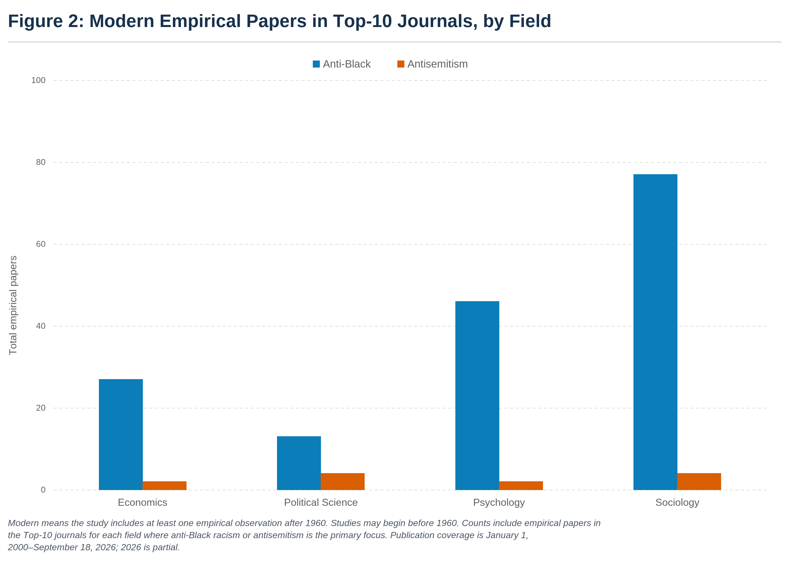

# Figure 2: Modern empirical papers in top-10 journals, by field



Empirical papers published January 1, 2000 – September 18, 2026 in ten leading journals in each of economics,
political science, psychology and sociology, whose primary focus is anti-Black racism or antisemitism and whose
study contains at least one empirical observation after 1960 (a study may begin before 1960).

| Field | Anti-Black | Antisemitism |
|---|---:|---:|
| Economics | 27 | 2 |
| Political Science | 13 | 4 |
| Psychology | 46 | 2 |
| Sociology | 77 | 4 |
| **Total** | **163** | **12** |

163 / 12 = 13.6 anti-Black papers per antisemitism paper. 2026 is a partial year.

## Reproduce

From the repository root, with the pinned requirements installed (see the [root README](../README.md)):

```bash
python figure2/scripts/build_figure2.py
python -m unittest discover -s figure2/tests -v
```

`build_figure2.py` is the only build script. It reads two inputs:

- [`data/source/racism_antisemitism_census_with_modern_figure_2.xlsx`](data/source/) — the census workbook
  (SHA-256 recorded in [`docs/checksums.json`](docs/checksums.json) and verified on every run);
- [`data/period_exclusions.csv`](data/period_exclusions.csv) — the 24 empirical Class A papers excluded because no
  empirical observation after 1960 was identified.

and then:

1. exports the workbook's census sheets to `data/master_census.csv`, `journal_universe.csv`, `codebook.csv`,
   `search_log.csv`, `completeness.csv` and `by_discipline.csv` (readable copies; do not edit them by hand);
2. selects the 199 Master Census records coded Class A and Empirical, applies the exclusions, and writes the
   paper-level ledger `data/figure2_papers.csv` (`include_figure2` = true for the 175 counted papers);
3. counts by field and subject and checks the result three ways: against the published counts, against the
   workbook's own `Figure 2` sheet (cells X2:Z5), and against the empirical-A totals in its `By Discipline` sheet;
4. writes `outputs/figure_2_counts.csv` and the chart (`.png`, `.svg`), drawn with the bundled Liberation Sans
   font ([`fonts/`](fonts/), SIL Open Font License) so the output is identical on every operating system.

Every output is deterministic: a rerun reproduces the committed CSV and SVG files byte for byte and the PNG pixel for
pixel (`python check_outputs.py` verifies this; CI runs it on every push).
The tests also rebuild the ledger from `master_census.csv` and compare it with the committed file.

### Where reproduction starts

The workbook is the earliest preserved artifact. The steps that produced it — journal selection, the
Crossref/OpenAlex harvest, keyword screening and model-assisted A/B/C and empirical coding — were carried out in a
ChatGPT conversation and have no executable code. They are documented by the
[original census prompt](prompts/00_original_census_prompt.md), the coding prompts in [`prompts/`](prompts/), the
workbook's `Codebook` and `Search Log` sheets, and the per-record `Coding reason`, `Matched terms` and `Review status`
columns of `master_census.csv`. Rerunning those prompts will not necessarily recover the same records: models,
retrieval coverage and judgments vary.

## Definitions

- **Subjects.** Both require a target group *plus* a discriminatory process; identity alone is not enough.
  *Anti-Black racism*: prejudice, stereotyping, unequal treatment, racial hierarchy, segregation, anti-Black violence
  or discriminatory institutions directed at Black people. *Antisemitism*: prejudice, stereotyping, unequal treatment,
  exclusion, persecution, violence or discriminatory institutions directed at Jews as Jews. A paper does not qualify
  merely because it studies Black or Jewish people, Israel, or Holocaust memory, or reports a group outcome gap.
- **Class.** A = primary focus (the discriminatory process and target group define the research question);
  B = substantial focus within a broader inquiry; C = incidental, identity-only, comparison-only, unsupported or
  non-substantive. Figure 2 counts Class A only.
- **Empirical.** Original quantitative, qualitative, experimental, computational, archival, historical-data or
  survey analysis. Theory, commentary, narrative reviews and systematic reviews/meta-analyses are nonempirical.
- **Modern-period rule.** A paper counts if its study contains at least one empirical observation after 1960.
  Publication date and observation dates are distinct; studies that begin before 1960 are kept if they extend past it.
  The rule was applied to all 199 empirical Class A records; the 24 failures are listed in `data/period_exclusions.csv`.
- **Journals.** Ten per field, chosen by a documented prestige composite (see `data/journal_universe.csv`), not a
  unique ordinal ranking. "Top 10" means this set.

The census screened 85,134 substantive-article proxy records and retained 2,113 candidate-subject records
(`data/master_census.csv`), including every exclusion, so the screening is auditable.

## An alternative time rule (not used)

An earlier "contemporary" version required a study's empirical data to *begin* after 1960, giving 151 anti-Black vs
10 antisemitism papers (19/1, 13/3, 46/2, 73/4). Only its totals survive — there is no paper-level ledger — and the
published post uses the modern chart, so this repository reproduces the modern version only.

## Files

| Path | What it is |
|---|---|
| `data/source/*.xlsx` | Census workbook: master census, journal universe, codebook, search log, summaries, Figure 2 sheet |
| `data/period_exclusions.csv` | Adjudicated modern-period exclusions (input) |
| `data/figure2_papers.csv` | Paper-level ledger of all 199 empirical Class A records with the inclusion decision (generated) |
| `data/*.csv` (others) | Sheet exports from the workbook (generated) |
| `outputs/` | Figure (PNG, SVG) and counts (generated) |
| `prompts/` | Original census prompt and reusable coding prompts (decision aids, not substitutes for review) |
| `docs/figure2-as-published.png` | The Figure 2 image embedded in the original Welcome essay |
| `docs/checksums.json` | SHA-256 of the workbook and the as-published image |
| `fonts/` | Liberation Sans 2.1.5 and its license |

## Limitations

- Abstracts and publication-type metadata vary across publishers; keyword screening misses papers whose title and
  available abstract mention neither the target group nor the discriminatory process.
- Classification was model-assisted from metadata; the period decision sometimes needs full-text review. Treat
  individual codes as auditable judgments, not verified facts.
- The figure counts papers, not citations, sample sizes, quality or importance, and does not by itself explain the
  disparity or identify an optimal allocation of research attention.

## Data dictionary (`figure2_papers.csv`)

| Column | Meaning |
|---|---|
| `record_id` | First 16 hex digits of SHA-256 of the lower-cased DOI/URL (or `journal|year|title` when absent) |
| `discipline`, `journal`, `publication_year`, `authors`, `title`, `doi_url` | From the Master Census |
| `subject` | `Anti-Black` or `Antisemitism` |
| `class`, `empirical_status` | Always `A` and `Empirical` in this file |
| `population_country` | Population or location from the census |
| `include_figure2` | `true` if counted in Figure 2 |
| `period_decision` | Short statement of the modern-period decision |
