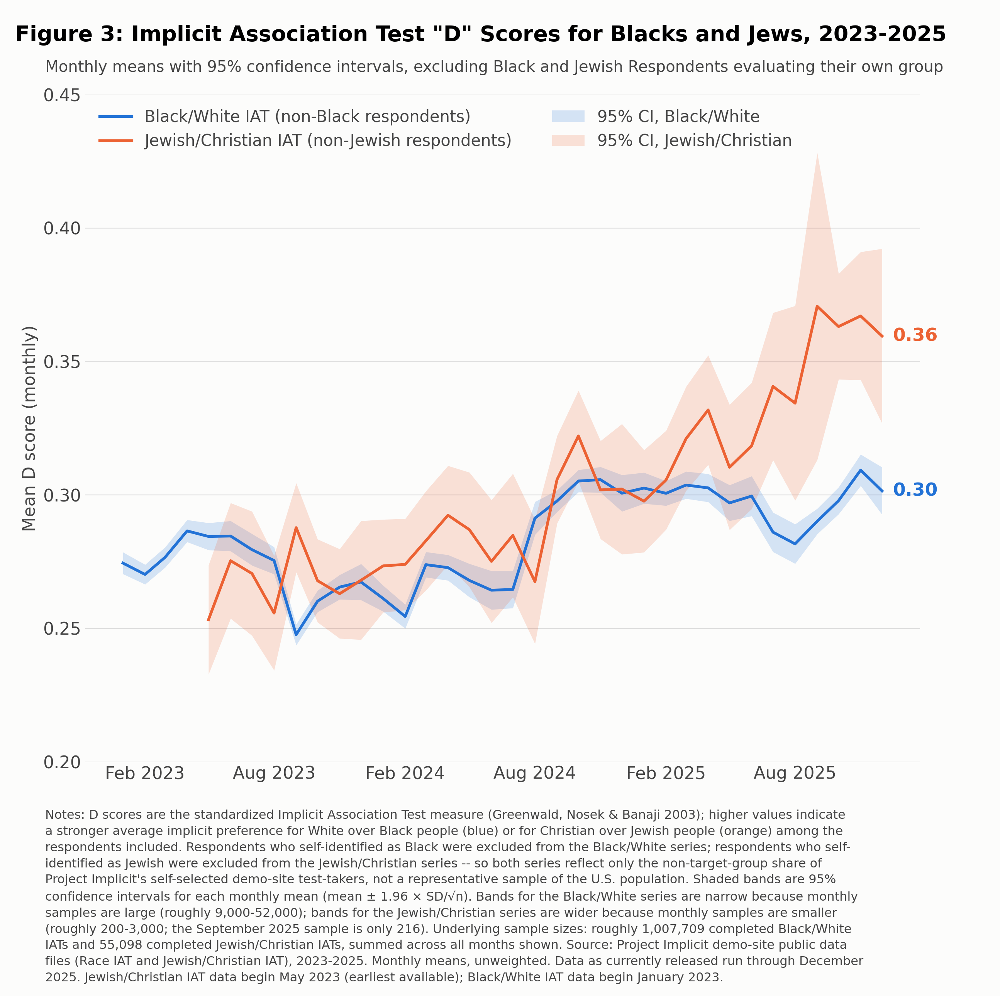

# Figure 3: Implicit Association Test "D" scores for Blacks and Jews, 2023–2025



Monthly mean IAT D scores with 95% confidence intervals, from Project Implicit's demo-site public data.
Black respondents are excluded from the Black/White (Race) IAT series and Jewish respondents from the
Jewish/Christian IAT series, since test-takers tend to favor their own group.

## Reproduce

```bash
python figure3/scripts/make_figure3.py
```

Reads the two monthly files in `data/` and writes `outputs/figure3_iat_black_jewish_ci.png`.

### Optional: rebuild the monthly series from the raw Project Implicit files

The raw respondent-level files (~1.6 GB unzipped) are not committed. Download them from Project
Implicit's demo-website datasets on OSF (<https://osf.io/y9hiq/>; the Jewish/Christian IAT archive is
<https://osf.io/tupn8/>), unzip, and run:

```bash
pip install pyreadstat
python figure3/scripts/build_iat_monthly.py \
  --jewish JewishIAT.public.2023-2025.sav \
  --race RaceIAT.public.2023.sav Race_IAT.public.2024.sav Race_IAT.public.2025.csv
```

This reproduces the committed `data/*.csv` files exactly (1,007,709 Race IAT and 55,098
Jewish/Christian IAT sessions).

## Method

| | Black/White (Race) IAT | Jewish/Christian IAT |
|---|---|---|
| D score | `D_biep.White_Good_all` | `D_biep.Christian_Good_all` |
| Positive means | White + good / Black + bad | Christian + good / Jewish + bad |
| Excluded | `raceomb002 == 5` (single-select "Black or African American", Jan–Feb 2023) or `raceomb_003_black == 1` (multi-select, Mar 2023 on) | anyone without `ident == 2` ("Do you consider yourself Jewish?" = No) |
| Coverage | Jan 2023 – Dec 2025 | May 2023 (earliest released) – Dec 2025 |
| Monthly n | ~9,000–52,000 | ~200–3,000 (Sep 2025: 216) |

Sessions are kept if dated 2023-01-01 or later with a non-missing overall D score (a completed IAT).
Monthly statistics are unweighted; the 95% CI is mean ± 1.96 × SD/√n.

## Caveats

- Project Implicit respondents are self-selected visitors to its demo site, not a representative sample.
- Low-n months for the Jewish/Christian IAT (Aug, Sep, Dec 2025) have wide intervals.
- As of October 2026 Project Implicit has not released 2026 files for either test.

`data/` columns: `month`, `d_mean`, `d_std`, `n`, `se`.
